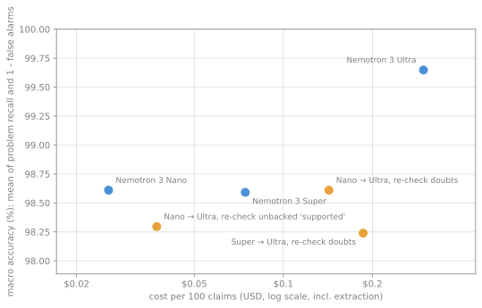

# ReceiptsBench results

ReceiptsBench scores a citation auditor on 30 reports with 300 cited sentences taken from 35 real sources. The sentences fall into 6 problem types plus supported controls, and were written by an independent model (`Qwen/Qwen3-235B-A22B-Instruct-2507`), not by a Nemotron judge. A label audit read each generated overclaim against its source and excluded 8 of them, so 292 items are scored. All numbers on this page come from `bench/results_final/*.jsonl` and `runs.json`, computed by `bench/report.py`.

## All reports

| Config | Items | Problem recall | False alarms | Macro accuracy | Label accuracy (4 classes) | Evidence quoted verbatim | Cost / 100 claims | Median s / report | Escalated |
|---|---|---|---|---|---|---|---|---|---|
| Nemotron 3 Ultra (`ultra`) | 292 | 99% (141/142) | 0% (0/150) | 99.6% | 98% (287/292) | 100% (228/228) | $0.2975 | 20 | - |
| Nemotron 3 Super (`super`) | 292 | 97% (138/142) | 0% (0/150) | 98.6% | 98% (285/292) | 100% (229/229) | $0.0744 | 17 | - |
| Nemotron 3 Nano (`nano`) | 292 | 98% (139/142) | 1% (1/150) | 98.6% | 97% (282/292) | 99% (224/226) | $0.0257 | 26 | - |
| Nano → Ultra, re-check unbacked 'supported' (`routed`) | 292 | 99% (140/142) | 2% (3/150) | 98.3% | 96% (281/292) | 100% (226/226) | $0.0373 | 29 | 2% (5/291) |
| Nano → Ultra, re-check doubts (`cascade_nano`) | 292 | 98% (139/142) | 1% (1/150) | 98.6% | 96% (281/292) | 100% (225/225) | $0.1425 | 28 | 39% (114/291) |
| Super → Ultra, re-check doubts (`cascade`) | 292 | 96% (137/142) | 0% (0/150) | 98.2% | 97% (283/292) | 100% (228/228) | $0.1861 | 20 | 37% (108/291) |

## By problem type

Share of items of each type predicted as a problem; for supported items, the share passed as supported.

| Config | number_swap | entity_swap | overclaim | misattribution | fabricated | dead_link | supported passed |
|---|---|---|---|---|---|---|---|
| Nemotron 3 Ultra (`ultra`) | 100% (37/37) | 97% (29/30) | 100% (15/15) | 100% (30/30) | 100% (15/15) | 100% (15/15) | 99% (149/150) |
| Nemotron 3 Super (`super`) | 95% (35/37) | 93% (28/30) | 100% (15/15) | 100% (30/30) | 100% (15/15) | 100% (15/15) | 99% (149/150) |
| Nemotron 3 Nano (`nano`) | 95% (35/37) | 100% (30/30) | 93% (14/15) | 100% (30/30) | 100% (15/15) | 100% (15/15) | 99% (148/150) |
| Nano → Ultra, re-check unbacked 'supported' (`routed`) | 100% (37/37) | 97% (29/30) | 93% (14/15) | 100% (30/30) | 100% (15/15) | 100% (15/15) | 97% (146/150) |
| Nano → Ultra, re-check doubts (`cascade_nano`) | 95% (35/37) | 100% (30/30) | 93% (14/15) | 100% (30/30) | 100% (15/15) | 100% (15/15) | 99% (148/150) |
| Super → Ultra, re-check doubts (`cascade`) | 95% (35/37) | 90% (27/30) | 100% (15/15) | 100% (30/30) | 100% (15/15) | 100% (15/15) | 99% (149/150) |

## Development and test reports

Reports r01–r10 are the development split, r11–r30 the test split.

| Config | r01–r10 macro accuracy | r01–r10 problem recall | r11–r30 macro accuracy | r11–r30 problem recall |
|---|---|---|---|---|
| Nemotron 3 Ultra (`ultra`) | 98.9% | 98% (46/47) | 100.0% | 100% (95/95) |
| Nemotron 3 Super (`super`) | 100.0% | 100% (47/47) | 97.9% | 96% (91/95) |
| Nemotron 3 Nano (`nano`) | 99.0% | 100% (47/47) | 98.4% | 97% (92/95) |
| Nano → Ultra, re-check unbacked 'supported' (`routed`) | 100.0% | 100% (47/47) | 97.4% | 98% (93/95) |
| Nano → Ultra, re-check doubts (`cascade_nano`) | 100.0% | 100% (47/47) | 97.9% | 97% (92/95) |
| Super → Ultra, re-check doubts (`cascade`) | 98.9% | 98% (46/47) | 97.9% | 96% (91/95) |

## Judge prompt v1 → v2

The v1 prompt results are in `bench/results`, the v2 prompt results in `bench/results_final`; each row compares the two on the same scored items. The v2 change: a claim that adds scope or certainty the source does not state (only, all, first, exactly, will solve, without interruption...) is `partial`.

| Config | Items | Macro accuracy, v1 prompt | Macro accuracy, v2 prompt | Overclaims detected, v1 prompt | Overclaims detected, v2 prompt |
|---|---|---|---|---|---|
| Nemotron 3 Ultra (`ultra`) | 292 | 98.6% | 99.6% | 87% (13/15) | 100% (15/15) |
| Nemotron 3 Super (`super`) | 292 | 97.6% | 98.6% | 93% (14/15) | 100% (15/15) |
| Nemotron 3 Nano (`nano`) | 292 | 97.9% | 98.6% | 93% (14/15) | 93% (14/15) |
| Nano → Ultra, re-check doubts (`cascade_nano`) | 292 | 97.9% | 98.6% | 80% (12/15) | 93% (14/15) |
| Super → Ultra, re-check doubts (`cascade`) | 292 | 97.5% | 98.2% | 93% (14/15) | 100% (15/15) |

## Cost and quality



## Label audit

Every generated overclaim was read against its source page (not against any model's output). Items whose strengthened wording is true or arguably supported by the source are not scored. (ReceiptsBench v1.1, audited 2026-10-19.)

| Report | Sentence | Reason |
|---|---|---|
| r03 | The Burj Khalifa was the first building in history to surpass Taipei 101 and become the tallest building in the world… | True as stated: the Burj Khalifa was the first building to surpass Taipei 101. |
| r04 | Apollo 11 was the American spaceflight that definitively achieved the first human landing on the Moon and was the fifth… | 'Definitively' adds emphasis to a true statement; it does not make it false. |
| r05 | The gapless human genome sequence including 22 autosomes and the X chromosome was the first and only fully sequenced… | 'First and only ... as of January 2022' is plausibly true at that date. |
| r12 | All known small honey bees are exclusively Apis florea and Apis andreniformis of southern and southeastern Asia [4]. | True: the subgenus Micrapis contains exactly these two species. |
| r15 | Iceland's capital and largest city is Reykjavík, the northernmost capital in the world, located at 64°08′N 21°56′W [1]. | The source page calls Reykjavik the world's northernmost capital of a sovereign state. |
| r19 | OpenAI GPT uses a left-to-right architecture where every token must attend to all previous tokens in the self-attention… | 'Every token must attend to all previous tokens' is a fair description of causal attention. |
| r24 | Lagos was governed directly by the Federal Government through the Lagos City Council without interruption until 1967… | 'Without interruption' is not stated, but nothing in the source contradicts it. |
| r29 | Data centre electricity consumption is projected to more than double to around 945 TWh by 2030, and will continue… | The same source projects about 1,200 TWh by 2035, so continued growth is supported. |

## Definitions

- **Problem recall**: share of non-supported gold items predicted as anything other than `supported` (an item with no extracted claim counts as not detected).
- **False alarms**: share of supported gold items predicted as non-supported (a missed item raises no alarm).
- **Macro accuracy**: mean of problem recall and (1 - false-alarm rate).
- **Label accuracy**: four classes: supported / misstated (partial or contradicted) / not_in_source / source_unavailable.
- **Evidence quoted verbatim**: share of supported, partial and contradicted predictions whose quote was found word for word in the fetched source.
- **Cost**: Token Factory tokens at the list prices per 1M tokens (nano $0.06 in / $0.24 out, super $0.30 in / $0.90 out, ultra $1.00 in / $3.00 out), including the Nano extraction shared by every configuration, per 100 audited claims (items excluded by the label audit were audited too). Tavily and OpenAlex calls are not priced.
- **Seconds**: extraction + source fetching + judging per report, measured with several reports audited in parallel.
- **Escalated**: two-tier configurations only: the share of answered claims that went to the second tier.
- `cascade`: Super judges, Ultra re-checks the doubts. `cascade_nano`: Nano judges, Ultra re-checks the doubts.
- `routed`: Nano checks every claim; Ultra re-checks only 'supported' verdicts whose quote does not show the claim's figures or absolute words.
- Gold labels: number_swap and entity_swap are `contradicted`, overclaim is `partial` (scored as a problem either way), misattribution is `not_in_source`, fabricated and dead_link are `source_unavailable`.

## Dataset

- Version `ReceiptsBench v1`, built 2026-10-19T20:53:58+00:00, random seed 20261020.
- 30 reports, 300 cited sentences, 292 scored after the label audit: 150 supported, 37 number_swap, 30 entity_swap, 15 overclaim, 30 misattribution, 15 fabricated, 15 dead_link.
- 35 real sources cited: 10 arxiv, 9 organisation, 16 wikipedia.
- Test items written by `Qwen/Qwen3-235B-A22B-Instruct-2507` (temperature 0.3), an independent non-NVIDIA model, so the Nemotron judges do not grade their own phrasing; number swaps are programmatic; every supported claim's quote is verified verbatim in its source; fabricated references are absent from Crossref (title ratio < 0.75); dead links answer 404/410.
- Generation: 169,096 input and 77,796 output tokens, $0.0805.

## Reproduce

```
uv run python bench/build.py --dry-run     # fetch and validate the sources, no LLM call
uv run python bench/build.py               # once; writes the frozen dataset to bench/data/
uv run python bench/run.py --out results_final   # all configurations; resumable; needs NEBIUS_API_KEY and TAVILY_API_KEY
uv run --group bench python bench/report.py --results results_final --baseline results
```
