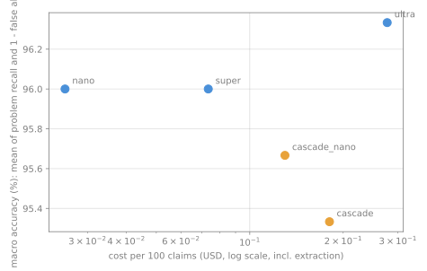

# ReceiptsBench v1 results

300 cited sentences in 30 reports, each with a gold label. Every number below is computed from `bench/results/*.jsonl` and `runs.json` by `bench/report.py`.

## Results per configuration

| Config | Problem recall | False alarms | Macro accuracy | Label accuracy (4 classes) | Evidence quoted verbatim | Cost / 100 claims | Median s / report | Escalated | Extraction coverage |
|---|---|---|---|---|---|---|---|---|---|
| nano | 93% (140/150) | 1% (2/150) | 96.0% | 94% (282/300) | 99% (232/234) | $0.0254 | 30 | - | 100% (299/300) |
| super | 93% (139/150) | 1% (1/150) | 96.0% | 95% (284/300) | 100% (236/236) | $0.0735 | 36 | - | 100% (299/300) |
| ultra | 94% (141/150) | 1% (2/150) | 96.3% | 94% (283/300) | 100% (234/234) | $0.2772 | 20 | - | 100% (299/300) |
| cascade | 91% (136/150) | 0% (0/150) | 95.3% | 94% (282/300) | 100% (236/236) | $0.1807 | 42 | 36% (107/299) | 100% (299/300) |
| cascade_nano | 91% (137/150) | 0% (0/150) | 95.7% | 93% (279/300) | 100% (232/232) | $0.1298 | 32 | 37% (110/299) | 100% (299/300) |

## Detection rate per problem type

| Config | number_swap | entity_swap | overclaim | misattribution | fabricated | dead_link | supported passed |
|---|---|---|---|---|---|---|---|
| nano | 95% | 97% | 70% | 100% | 100% | 100% | 98% |
| super | 95% | 90% | 74% | 100% | 100% | 100% | 99% |
| ultra | 100% | 100% | 61% | 100% | 100% | 100% | 98% |
| cascade | 95% | 87% | 65% | 100% | 100% | 100% | 99% |
| cascade_nano | 97% | 93% | 57% | 100% | 100% | 100% | 99% |

## Definitions

- **Problem recall**: share of non-supported gold items predicted as anything other than `supported` (an item with no extracted claim counts as not detected).
- **False alarms**: share of supported gold items predicted as non-supported (a missed item raises no alarm).
- **Macro accuracy**: mean of problem recall and (1 - false-alarm rate).
- **Label accuracy**: four classes: supported / misstated (partial or contradicted) / not_in_source / source_unavailable.
- **Evidence quoted verbatim**: share of supported, partial and contradicted predictions whose quote was found word for word in the fetched source.
- **Cost**: Token Factory tokens at the list prices per 1M tokens (nano $0.06 in / $0.24 out, super $0.30 in / $0.90 out, ultra $1.00 in / $3.00 out), including the Nano extraction shared by every configuration. Tavily and OpenAlex calls are not priced.
- **Seconds**: extraction + source fetching + judging per report, measured with several reports audited in parallel.
- **Escalated**: cascade configurations only; `cascade` is Super then Ultra, `cascade_nano` is Nano then Ultra.
- Gold labels: number_swap and entity_swap are `contradicted`, overclaim is `partial` (scored as a problem either way), misattribution is `not_in_source`, fabricated and dead_link are `source_unavailable`.



## Dataset

- Version `ReceiptsBench v1`, built 2026-10-19T20:53:58+00:00, random seed 20261020.
- 30 reports, 300 cited sentences: 150 supported, 37 number_swap, 30 entity_swap, 23 overclaim, 30 misattribution, 15 fabricated, 15 dead_link.
- 35 real sources cited: 10 arxiv, 9 organisation, 16 wikipedia.
- Test items written by `Qwen/Qwen3-235B-A22B-Instruct-2507` (temperature 0.3), an independent non-NVIDIA model, so the Nemotron judges do not grade their own phrasing; number swaps are programmatic; every supported claim's quote is verified verbatim in its source; fabricated references are absent from Crossref (title ratio < 0.75); dead links answer 404/410.
- Generation: 169,096 input and 77,796 output tokens, $0.0805.

## Reproduce

```
uv run python bench/build.py --dry-run     # fetch and validate the sources, no LLM call
uv run python bench/build.py               # once; writes the frozen dataset to bench/data/
uv run python bench/run.py                 # all configurations; resumable; needs NEBIUS_API_KEY and TAVILY_API_KEY
uv run --group bench python bench/report.py
```
